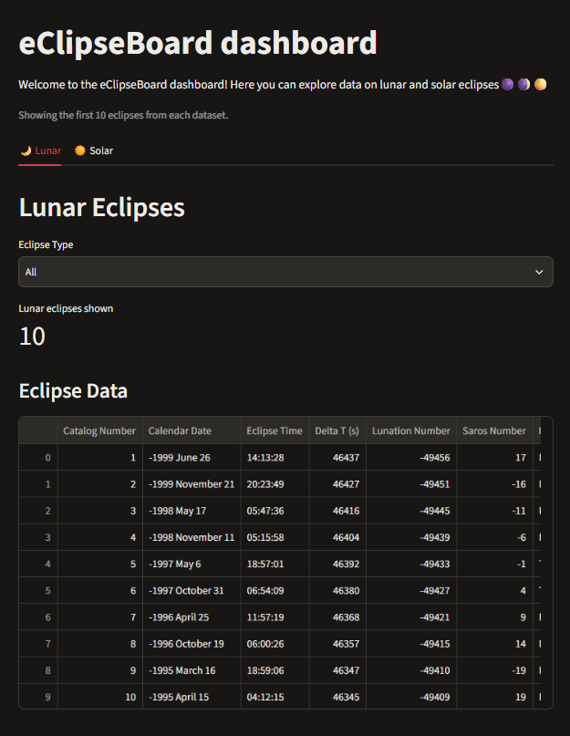

# eClipseBoard


A fullstack dashboard about solar and lunar eclipses, built with FastAPI and Streamlit, containerized with Docker and deployed to Azure. Built as part of the Data Engineering program at STI, inspired by the solar eclipse on 12 August 2026.

The focus of the project is the cloud infrastructure: building the application locally, dockerizing it and deploying it to Azure.



## Architecture

```
┌──────────────────────┐   HTTP    ┌──────────────────────┐
│  Frontend            │ ────────► │  Backend             │
│  Streamlit :8501     │           │  FastAPI :8000       │
│  dashboard.py        │ ◄──────── │  api.py + CSV data   │
└──────────────────────┘   JSON    └──────────────────────┘
```

- **Backend:** a FastAPI app that reads the eclipse data with pandas and serves it through two endpoints, `/lunar/data` and `/solar/data`
- **Frontend:** a Streamlit dashboard that fetches data from the backend with `httpx` and shows it in tabs, with a filter on eclipse type
- **uv workspace:** backend and frontend are separate packages with their own dependencies in one repository

### Deployment

```
Local (uv)  →  Docker images  →  Azure Container Registry  →  Azure App Service (Web App)
```

1. Each service has its own Dockerfile, and `docker-compose.yaml` runs them together. The frontend reaches the backend at `http://backend:8000` through the `BACKEND_URL` environment variable.
2. The images were tagged and pushed to **Azure Container Registry**.
3. The containers were deployed to an **Azure App Service Web App**.

The resource group was deleted after the project was finished to avoid ongoing costs, so the app is no longer live.

## Project structure

```
├── backend/
│   ├── data/                  # lunar.csv and solar.csv
│   └── src/backend/           # FastAPI app and data processing
├── frontend/
│   └── src/frontend/          # Streamlit dashboard
├── dockerfiles/               # one Dockerfile per service
├── docker-compose.yaml
├── EDA.ipynb                  # short exploration of the data
└── pyproject.toml             # uv workspace
```

## How to run locally

Requires Docker.

```bash
docker compose up --build
```

Then open the dashboard at http://localhost:8501. The API is available at http://localhost:8000/docs.
